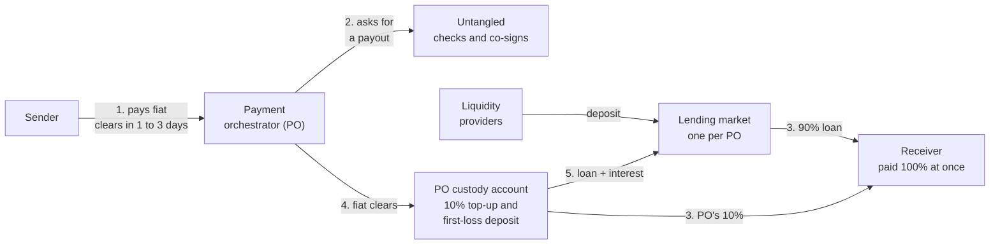

# The problem and the model

## The problem

A payment orchestrator (PO) moves money across borders for its clients. A
sender pays the PO in fiat, for example by bank transfer in the US, and expects
the receiver to be paid at once. The fiat reaches the PO one to three days
later. Until it does, the PO pays out of its own balance sheet, so the size of
that balance sheet caps how much it can pay out each day.

## The model

Each payout is split in two:

- **90% from liquidity providers (LPs):** a short loan from a lending market
  that LPs fund, open only to this PO.
- **10% from the PO:** paid from the PO's own custody account, in the same
  transaction as the loan.

A second transaction right after pays the receiver 100%. When the fiat clears,
the PO repays the loan with interest and keeps the rest.

The PO also keeps a first-loss deposit in its custody account. The deposit is
locked: moving it needs a trusted third party's signature as well as the
PO's, and the signing service refuses any loan larger than the deposit. If the
PO fails to repay, the deposit is meant to absorb the loss before the LPs do.
How it is applied is part of the legal terms still to agree.

Steps 2 and 3 are two Stellar transactions. The **advance** borrows the 90% and
brings the PO's 10% from custody, so the PO's settlement account holds the
whole face value. The **release** then pays the receiver in full. Both need the
PO's key and Untangled's key, and the receiver can be any account that passes
Untangled's screening. Step 5 needs the PO's key alone, so the PO can always
repay, whatever happens on Untangled's side.

## Who takes part

| Party | Role |
|---|---|
| Payment orchestrator (PO) | The borrower. Confirms each pay-in, asks for each payout, funds 10% of it, keeps the first-loss deposit and the collateral cover, and repays when the fiat clears |
| Untangled (signing service) | Screens every receiver, ties each advance to the pay-in it funds, checks live limits, co-signs the advance and the release, and keeps the line's records. The on-chain rules bound every position whatever the service does |
| Liquidity providers (LPs) | Deposit stablecoin into the PO's lending market and earn the interest |
| Receivers | The people or businesses paid out: any Stellar account or contract that passes Untangled's screening |
| Trustee | A trusted third party that co-signs any movement of the PO's own money out of its custody account, so the PO cannot take back its first-loss deposit alone |

## Collateral cover

Besides the payment obligations it borrows against, the PO locks a basket of
assets in its settlement account. On testnet the basket is XLM, counted at 80%
of its price, and a test USDC, counted at 95%. The borrowed stablecoin is never
part of it. Each advance must leave the basket's counted value at 20% of the
debt or more, checked on chain. When the cover falls below 15%, anyone may
liquidate part of the position. [Limits and protections](./05.limits-and-protections.md)
has every figure.

## Economics

Pricing is open: the borrower's rate, any facility fee and the LPs' return are
still to agree. The testnet market charges a fixed 10% a year, and the example
uses that rate as an illustration.

| Item | Amount |
|---|---|
| Pay-in from the sender | 1,000 |
| Paid to the receiver today | 1,000 |
| Lent by the LPs (90%) | 900 |
| Paid by the PO from custody (10%) | 100 |
| Interest on 900 for two days at 10% a year | 0.49 |
| Repaid by the PO when the fiat clears | 900.49 |
| Returned to the PO's custody account | 99.51 |

The PO pays interest on the 90% for the days the fiat is in transit, and its
10% comes back when the fiat clears. The first-loss deposit stays in custody
throughout. On testnet the deposit is 15,000 and the PO keeps a further 5,000 as
working balance for top-ups and repayments.

## Why a Prime account

- **A borrowing account bound by policy:** the PO's settlement account is a
  Prime smart account. Its rules fix what an advance can do: mint the payment
  obligation, post it, borrow at most the per-payout cap and add at most the
  top-up cap from custody. A separate rule lets the PO and Untangled together
  pay a receiver, at most 15,000 in one transaction. The chain refuses any
  other transaction, whoever signs it.
- **Checks that hold without the service:** before each advance the payout
  rule reads the lending market, the price feeds and the basket, and checks the
  cover, the price age and the line cap. A compromised signing service cannot
  skip them.
- **Repayment and liquidation without Untangled:** the PO repays with its own
  key alone, and a liquidator acts alone in one transaction. Neither needs a
  signature from Untangled.
- **A public record:** each advance shows the obligation minted, the loan and
  the top-up; each release shows the payment; each repayment shows the loan
  repaid and the obligation burned. An LP, an auditor or the PO can read every
  one on a public explorer.
