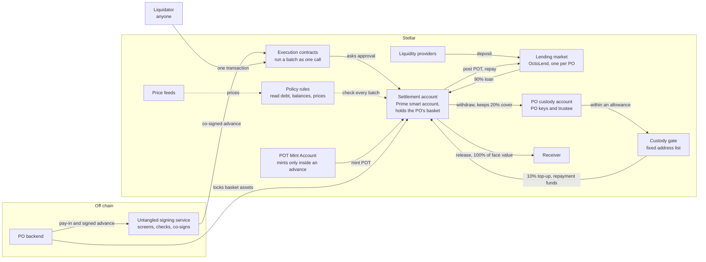

# How it works

A **line** is one PO's set-up: its lending market, its payment obligation
token, its custody account, its settlement account with the rules on it, and
the signing service's records for it. Each PO gets its own line.

## The design in eight points

1. **Payment obligations:** each pay-in becomes a Payment Obligation Token
   (POT), one per dollar of the pay-in's face value. An off-chain contract
   between Untangled and the PO backs it. The chain never reads that contract.
2. **A basket of cover:** the PO keeps a basket of assets in its settlement
   account as on-chain cover. The borrowed stablecoin is never in it.
3. **An advance is bounded three ways:** the basket's counted value must be at
   least 20% of the debt after the draw, the debt must stay within the line cap,
   and every price in the check must be fresh and inside a fixed band. Each
   advance also borrows at most 90% of the POT posted, and the PO adds the other
   10% from custody.
4. **Release and repay:** a second transaction releases the full face value to
   the receiver. The PO repays alone when the fiat clears, so a fault on
   Untangled's side never blocks repayment.
5. **Withdrawal keeps 20%:** the PO can take cover out of the settlement
   account, and the chain refuses any withdrawal that leaves less than 20% of
   the debt covered.
6. **Liquidation by anyone:** when the cover falls below 15% of the debt, anyone
   can liquidate in one transaction it signs alone. It repays at most half the
   debt and takes basket assets worth at most 5% more than it paid. No key of
   Untangled's signs it.
7. **Take-over with notice:** if the PO defaults, Untangled queues a take-over.
   After a fixed wait Untangled's recovery account runs it, and the chain checks
   the debt and the price again at that moment. A repayment by the PO during the
   wait, or a price that moved against the PO, makes the run fail.
8. **Freeze:** Untangled can freeze a line. The service then signs no advance,
   release or withdrawal. Repayment, liquidation and take-over keep working.

## Accounts, contracts and money flows

The settlement account is the market's borrower. It holds money only between an
advance and its release, plus the PO's basket. Every call that moves money goes
through one of its two execution contracts, and the account authorises a call
only when one of its rules permits it. The gated execution contract carries the
PO's flows and stores take-overs; the gate-free one carries a liquidation and
the take inside a take-over's run.

## Who signs, and what the chain checks

| Flow | Who signs | What the chain checks |
|---|---|---|
| Advance: mint, post, borrow, top-up | PO operations key and the signing-service key; the service also signs the mint and pays the fee | Exactly four calls in order. Borrow at most 90% of the POT posted and at most 13,500; top-up at most 1,500. Basket cover at least 20% of the debt after the draw. Debt after the draw within 50,000. Every price at most 300 seconds old and inside its band. The mint works only inside this batch |
| Release | PO operations key and the signing-service key | One stablecoin transfer from the settlement account, at most 15,000. The service screens the receiver first |
| Repay | PO operations key alone | Exactly four calls: pull from custody, repay the market, withdraw the POT, burn it. The pull is at most the POT withdrawn |
| Withdraw cover | PO operations key and the signing-service key | One transfer of a basket asset to the PO's custody account, leaving 20% of the debt covered at fresh prices |
| Liquidate | The liquidator alone, as the transaction's source | Exactly five calls: the liquidator's stablecoin in, a basket asset out to the same liquidator, repay, withdraw, burn. Only while the cover is below 15% of the debt; repays at most half the debt; takes at most 105% of the repayment's value at a fresh price |
| Take-over, queue | Signing-service key and Untangled's admin key | One call stored for exactly the wait, with the recovery account paying and receiving, at a fair price at queue time |
| Take-over, run | Untangled's recovery account, after the wait | At run time: repayment at most the debt, the price fresh and inside its band, the asset taken worth at most 105% of the repayment. If any check fails, the whole run fails |
| Cancel a take-over | Both owners, or the PO's operations key once its debt is 0 | The stored batch exists |
| Freeze | Untangled's operator, at the signing service | No chain rule: the service stops co-signing advances, releases and withdrawals |
| Anything else | Both owners of the settlement account: the PO's admin key and Untangled's admin key | The owners' own seat: set-up, sweeping leftover funds to custody, changing rules |

Each line holds 21 rules: 20 on the settlement account and the mint rule on the
POT Mint Account. The figures in the table are the testnet lines' values.

## Who holds which key

| Key | Held by | Powers |
|---|---|---|
| PO admin key | PO | Owner seat on the settlement account, together with Untangled's admin key |
| PO operations key | PO | Signs every advance, release, repayment and cover withdrawal; the only signer of a repayment and of the PO's take-over cancel |
| PO API keys | PO | Sign requests to the signing service and read the line's private data; up to 16 per line |
| PO custody keys A and B | PO | Custody account signers, weights 10 and 5 on the beta line |
| Trustee key | Trusted third party | Custody account signer, weight 5 |
| Untangled admin key | Untangled | Owner seat on the settlement account; owner of the POT Mint Account; market admin; second signer on take-overs |
| Signing-service key | Untangled | Co-signs advances, releases and withdrawals; the only signer of the mint rule |
| Recovery key | Untangled | Pays and receives in a take-over's run; holds no seat on any account |
| Price feeder key | Untangled | Sets prices on the admin-gated feeds, inside the bands the rules apply |

The custody account needs weight 20 for any payment, allowance or contract
deployment, so on the beta line every direct movement of the PO's money needs
both PO custody keys and the trustee. The settlement account's owner seat needs
both admin keys, so neither the PO nor Untangled can change its rules alone.

## Off chain

| Role | Run by | What it does |
|---|---|---|
| PO backend | PO | Confirms each pay-in, signs its half of each advance and release, repays when the fiat clears, locks and withdraws cover |
| Signing service | Untangled | Screens each receiver, checks each advance against its pay-in and the line's live limits, co-signs, applies the freeze, queues and runs take-overs, submits advances and pays their fees, and records every advance, repayment, liquidation and take-over it reads from the chain |

The signing service runs on Cloudflare Workers, with one record store per line.
It answers at `https://payfi-beta.untangled.finance` on testnet.

## The protocols underneath

| Part | Protocol | What it does here |
|---|---|---|
| Lending market | [OctoLend](../OctoLend/03.lending-market.md) | One market per PO lends the stablecoin against POT, with a liquidation threshold (LLTV) of 95%. On testnet it charges a fixed 10% a year with no protocol fee |
| Settlement account and POT Mint Account | [Untangled Prime](../Prime/02.how-prime-works.md) | OpenZeppelin smart accounts on Stellar, with policy rules checked on chain |
| Policy interpreter | [OctoGate](../OctoGate/prime-contracts.md#policy-interpreter) | Judges each call against a rule, including reads of the debt, balances and prices |
| Execution contracts | [OctoGate](../OctoGate/prime-contracts.md#execution-contract) | Run a list of calls as one; the gated one also stores a take-over for its wait |
| Custody gate | [OctoGate](../OctoGate/prime-contracts.md#custody-gate) | The only route for the PO's money out of custody without the trustee: to a fixed list of addresses, within an allowance custody sets |
| Price feeds | Untangled, admin-gated | XLM at Reflector's mainnet price, and the test USDC and POT at 1.0. A production line uses an existing audited oracle |
