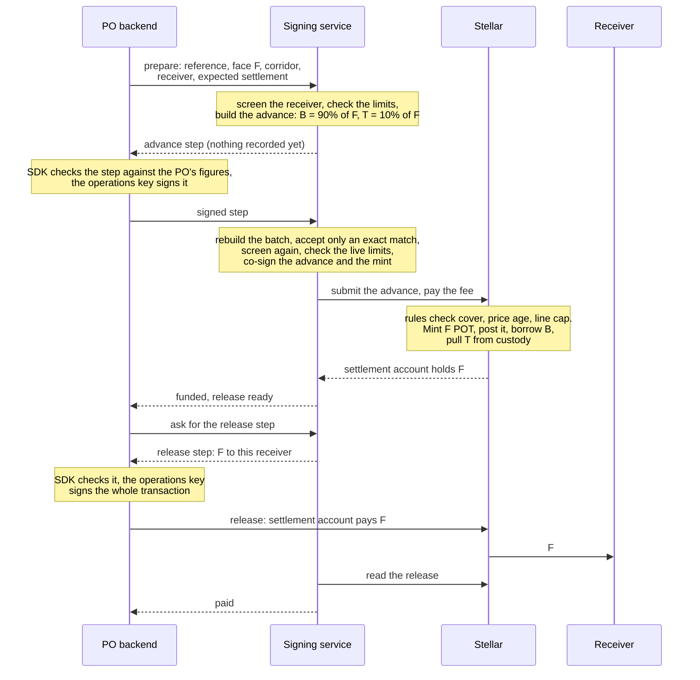
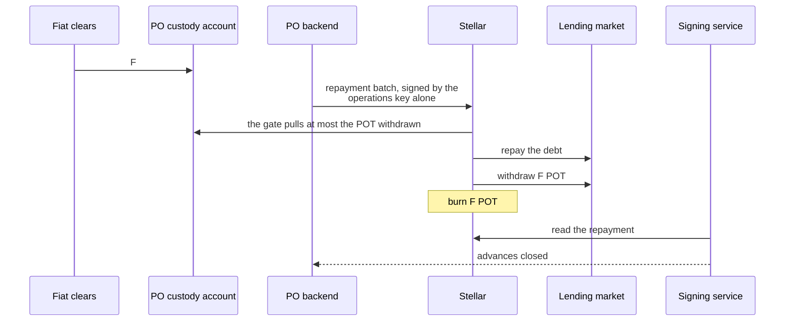
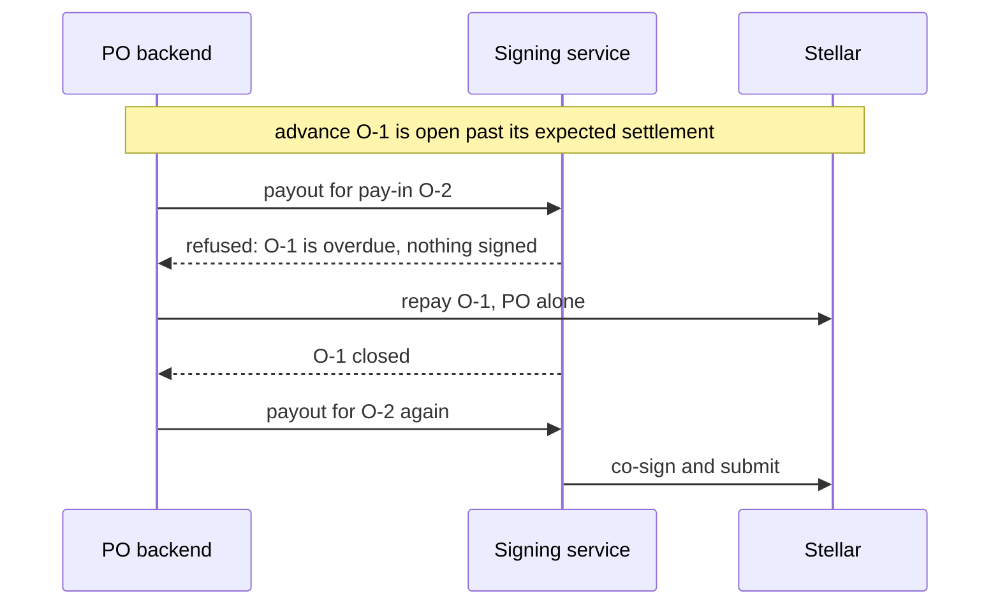
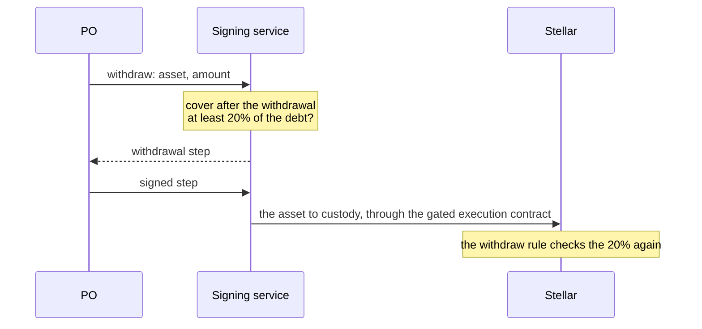
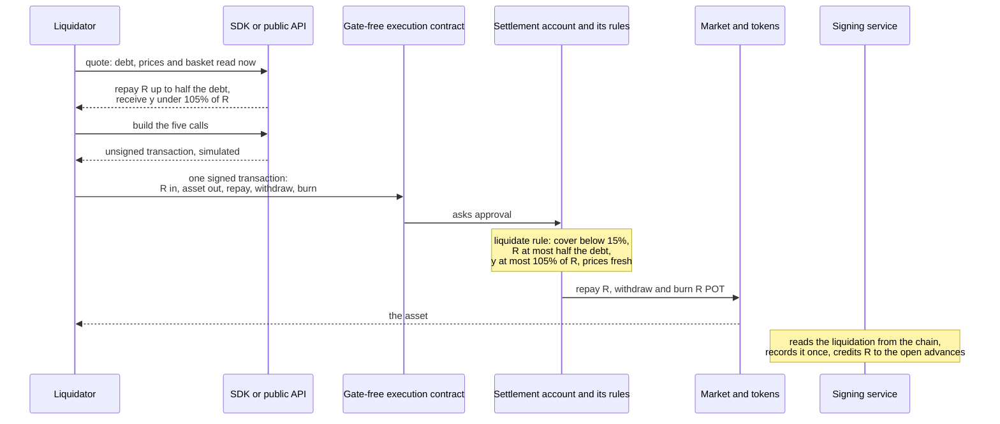
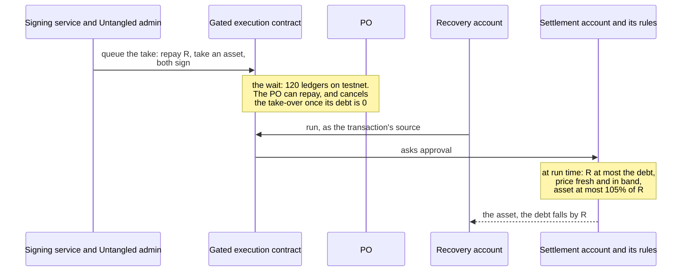

# Flows

F is a pay-in's face value, B the loan (90% of F) and T the PO's top-up (10% of
F). The code for each flow is in [Flows in code](./06.integration/04.flows-in-code.md).

## A payout, in two transactions

The custody gate pays only the addresses fixed in its list when it was
deployed, and the execution contract refuses any batch that names another
address. A receiver chosen at payout time cannot appear in that batch, so the
payout is split. The **advance** runs through the execution contract and names
no receiver. The **release** is a plain stablecoin transfer from the settlement
account.

Nothing is recorded when a payout is prepared, and the step must be signed
within about a minute (12 ledgers) or prepared again. The pay-in exists once the
PO's operations key has signed the advance step. A release stays valid for 60
ledgers, about five minutes; once it lapses the PO asks for a renewal for the
same receiver and amount. Several payouts can be in flight at once, up to
15,000 funded and unreleased in total, because one release moves at most that
much.

## Repayment by the PO alone

The PO repays with its own key, and the signing service plays no part on chain,
so a fault on Untangled's side never blocks a repayment. One repayment can close
several advances. A partial repayment must close at least one advance whole;
[Flows in code](./06.integration/04.flows-in-code.md#repay-part) gives the
exact limit. A repayment closes only advances whose money has left the
settlement account, so release an advance before repaying it.

## Overdue suspension

An advance open past its expected settlement suspends every new payout until it
is repaid. The same suspension applies while the market's loan-to-value is
above 92%, and while the settlement account holds funds outside the expected
flow, until both owners sweep them back to custody.

## Withdrawing cover

## Liquidation

When the cover is below 15% of the debt, anyone can liquidate, alone and in one
transaction. The liquidator gets a quote, builds the five-call batch, signs it
once as the transaction's source and sends it. The SDK does all of it from chain
reads, and the signing service offers the same transaction as a step that it
only relays. The quote leaves a buffer of 50 basis points under the rule's 105%
edge, so a small price rise before the transaction runs still passes.

The signing service learns of each liquidation from the chain and records it
once, whoever sent it.

## Take-over after a default

If the PO defaults, Untangled queues a take-over, waits, and then runs it. The
chain judges the terms when it runs.

A repayment during the wait, or a price that moved, makes the run fail whole.
The 120-ledger wait (about ten minutes) is a testnet setting; a production line
sets its own.

## Freeze

Untangled's admin can freeze a line with a reason and lift the freeze later.
While a line is frozen the service signs no advance, release or withdrawal.
Repayment, liquidation and take-over keep working, so a freeze never traps the
PO's debt or its cover.
