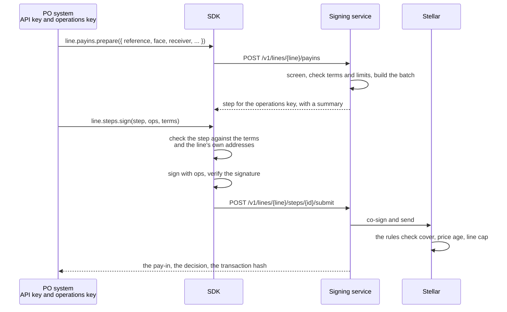

# Integration overview

A PO's systems talk to Untangled's signing service through the TypeScript SDK,
[`@crediolabs/payfi-sdk`](https://www.npmjs.com/package/@crediolabs/payfi-sdk).
The PO uses it to fund payouts, release them to receivers, repay the market and
withdraw cover. Untangled's operator uses it to freeze a line, run take-overs
and change market settings. A liquidator can use it with no service at all.

| | |
|---|---|
| Package | `@crediolabs/payfi-sdk` |
| Version | 0.2.2, tagged `latest` and `next` |
| Runs on | Bun 1.3 or later, Node 22.12 or later |
| Peer dependency | `@stellar/stellar-sdk` ^14.4.0 |
| Network | Stellar testnet |
| Service | `https://payfi-beta.untangled.finance` |
| Licence | MIT |

The SDK is published under the `@crediolabs` npm scope by CredioLabs, the AI
brand of Untangled Finance Limited. Use 0.2.2 or later. A client older than 0.2.0 refuses the current liquidation
steps, and 0.1.0 and 0.1.1 are deprecated.

## Who builds and who signs

The signing service builds every batch and every transaction of the PO's flows.
Each flow that moves money or changes a contract comes back as a **step**: the
authorisation or the transaction that one listed key must sign, with a summary
of what it does. The SDK then does the part a PO keeps to itself: it compares
the step with the PO's own figures and signs locally. Keys stay with the
caller.

The service holds the pay-in data, the screening and the line's history, so it
decides whether a payout may happen. The chain's rules decide whether the batch
is safe, whatever the service says.

## Entry points

Six imports, each with its own job. Most callers need only `api` and
`signing`.

| Import | Holds | Runs in |
|---|---|---|
| `@crediolabs/payfi-sdk/api` | `createClient`: the signing service's v1 API as typed calls, `steps.sign`, `signRequest`, `checkStepTerms` | Browser, server |
| `@crediolabs/payfi-sdk/signing` | Signers (`keypairSigner`, `walletSigner`, `primeWalletSigner`, `approvalSigner`), preimage and signature checks | Browser, server |
| `@crediolabs/payfi-sdk/core` | The line registry types, batches, rule intents, the basket, cover and interest arithmetic, the liquidation batch and quote, the request message, `PayfiError` | Browser, server |
| `@crediolabs/payfi-sdk/chain` | `connect(TESTNET)`: chain reads (position, holdings, market), contract code checks, `chain.liquidations` and `chain.takeovers` | Server |
| `@crediolabs/payfi-sdk/admin` | `planLine`, `apply`, `verifyLine`: a new line's set-up as a plan, its run, and the check of a live line | Server |
| `@crediolabs/payfi-sdk/networks` | `TESTNET`, `MAINNET`, the contract code pins per network, `assertReady` | Browser, server |

The package also ships the service's API as OpenAPI 3.1, at
`@crediolabs/payfi-sdk/openapi/payfi-v1.yaml`.

## Networks

The SDK runs on Stellar testnet today. Stellar mainnet and other networks are
planned.

Mainnet needs three things first: the sha256 pins of the code each PayFi
contract must run, the simple-threshold policy, and a mainnet policy interpreter
pinned by `@crediolabs/policy-synth`. Until all three are set, `planLine`,
`apply`, `steps.sign`, every signer and the chain's code checks throw
`MAINNET_NOT_READY`, and no option turns that off. The signing service loads no
mainnet line, so a call to one answers 404 `LINE_NOT_FOUND`.

## Pages in this section

| Page | What it covers |
|---|---|
| [Quick start](./02.quick-start.md) | Install the SDK, keep the keys in `.env` and read a market |
| [Auth](./03.auth.md) | Roles, signed requests, read grants and the two keys of an automated PO |
| [Flows in code](./04.flows-in-code.md) | One example for each flow, from a payout to a take-over |
| [Steps and terms](./05.steps-and-terms.md) | What the SDK checks before a key signs, and how a step ends |
| [Errors](./06.errors.md) | Every error code, and what to do about it |
| [API reference](./07.api-reference.md) | The routes, the conventions and the OpenAPI spec |
