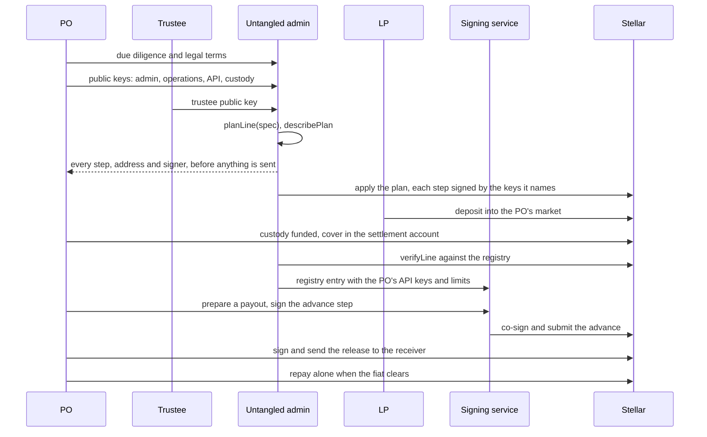

# Onboarding a payment orchestrator

This guide takes a PO from first contact to its first funded payout and
repayment, in twelve steps and five phases. Each step says who acts, what they
do and how to check it. Items still to agree are marked **To agree**.

The figures are the testnet beta's. A production line sets its own, and the SDK
and the signing service refuse mainnet today.

| Phase | Steps | Main actors |
|---|---|---|
| A. Before set-up | 1 Terms, 2 Trustee, 3 Keys, 4 Line terms | PO, Untangled, trustee |
| B. Set-up | 5 Plan and review, 6 Apply, 7 Verify and register | Untangled admin, PO admin, custody signers, trustee |
| C. Funding | 8 First-loss deposit, working balance, cover and liquidity | PO, LPs |
| D. Connection | 9 Connect the PO's systems, 10 Receivers and corridors | PO engineer |
| E. First payout | 11 Advance, release, repayment, 12 Go-live checks | PO, signing service |

## A. Before set-up

### 1. Commercial and legal terms

- **Who:** the PO and Untangled.
- **What:** Untangled carries out due diligence on the PO. For the beta, that
  due diligence, the first-loss deposit and the overdue suspension stand behind
  the PO's confirmation that each pay-in happened. The parties agree the legal
  terms: the agreement with the PO, the trustee's rights and the LPs' rights.
  An off-chain POT contract between Untangled and the PO backs each Payment
  Obligation Token the line mints.
- **Result:** a PO accepted for a line, and a POT contract.
- **To agree:** the eligibility criteria and onboarding checks for a PO, the
  legal terms, how the first-loss deposit is applied in a default, and pricing
  (the borrower's rate, any facility fee and the LPs' return).

### 2. Appoint the trustee

- **Who:** the PO and Untangled agree on a trusted third party, which provides
  its public key.
- **What:** the trustee becomes a signer on the PO's custody account. Custody
  needs weight 20 for any payment, allowance or contract deployment; on the beta
  line the PO's two custody keys carry 15 between them and the trustee 5. The PO
  therefore cannot take back its first-loss deposit, or deploy and approve a
  custody gate, without the trustee. This holds only while the PO's own weights
  stay below the threshold. The trustee's mandate must say that it never
  co-signs a take-over cancel or a change of the execution contract's gate while
  the line has debt, since custody with the trustee can do both.
- **Result:** a trustee key and a written mandate.
- **To agree:** who the trustee is in production.

### 3. Create the keys

- **Who:** the PO creates its keys and accounts and sends Untangled the public
  addresses. Untangled creates its own.
- **What:** one key per role. The SDK's line plan refuses a specification where
  one key holds two roles, because that key could then act alone where a rule
  wants two parties.

| Key | Held by | What it does |
|---|---|---|
| PO admin key | PO | Co-owner of the settlement account with Untangled's admin key |
| PO operations key | PO | Signs every advance, release, repayment and cover withdrawal. Source of the release and repayment transactions, so it pays their network fees and needs XLM |
| PO API keys | PO | Sign requests to the signing service and read the line's private data; up to 16 per line |
| Custody account | PO | A Stellar account. Its master key signs the first set-up step and is then switched off |
| Custody keys A and B | PO | Custody signers |
| Trustee key | Trustee | Custody signer (step 2) |
| Untangled admin key | Untangled | Co-owner of the settlement account, owner of the POT Mint Account, market admin, second signer on take-overs |
| Signing-service key, fee payer, recovery key, price feeder | Untangled | Co-sign, submit and pay for advances, run take-overs, set prices |

- **Check:** for real money, keep the operations key in an MPC wallet or a
  hardware security module and sign through `approvalSigner`
  ([Auth](./06.integration/03.auth.md#the-two-keys-of-an-automated-po)).

### 4. Agree the line's terms

- **Who:** the PO and Untangled.
- **What:** the on-chain limits that go into the rules, the market settings,
  the basket and its weights, and the signing service's limits.
  [Limits and protections](./05.limits-and-protections.md) lists each one with
  its testnet value.
- **Result:** a line specification (keys, limits, market, basket, custody
  signers and threshold, gate address list, custody allowance and funding, LP
  deposit and first cover) and the line's service limits.
- **To agree:** production values for every figure, the basket assets and their
  oracles for mainnet (an existing audited oracle), and the stablecoin.

## B. Set-up through the SDK

### 5. Plan the line and review the plan

- **Who:** Untangled's admin builds the plan. The PO reviews it.
- **What:** `planLine(spec)` from `@crediolabs/payfi-sdk/admin` turns the
  specification into every set-up step. Contract addresses come from salts, so
  the plan lists every address before the first transaction. `describePlan(plan)`
  prints one line per step with the keys that sign it; the `beta-2` line's plan
  had 54 steps.
- **Check (PO):** the PO admin key sits in the settlement account's owner seat
  beside Untangled's admin key; the custody signers, weights and threshold are
  the agreed ones; the gate's address list is the expected one; the limits
  match step 4.
- **To agree:** a formal sign-off of the plan by the PO.

### 6. Apply the plan

- **Who:** Untangled's admin runs `apply(plan, { rpc, keys, state })`. Each step
  is signed by the keys it names.
- **What:** the plan sets up the POT asset, the custody account, the price feed
  and the market, the settlement account and the POT Mint Account, the two
  execution contracts, the custody gate with its allowance, the 21 rules, the LP
  deposit and the first cover. `apply` records each finished step, so a failed
  run resumes where it stopped.
- **Check:** each step's transaction hash, written to the state file as it
  completes.
- **To agree:** `apply` needs every key the remaining steps name in one process.
  On testnet Untangled holds every key; how a production PO signs its own
  set-up steps (PO admin, custody, trustee) with keys it keeps is still to
  design.

### 7. Verify the line and register it

- **Who:** Untangled.
- **What:**
  1. `verifyLine` checks the live line against its registry entry: each
     contract's code against the pinned build, each rule's predicate, scope,
     signers, threshold and policy set, the gate's list, the execution
     contracts and the POT's admin. On 19 October 2026 it passed 126 checks on
     each testnet line.
  2. The line's registry entry gets the PO's name and its API keys. The
     registry decides each caller's role.
  3. The signing service gets the line's service keys, and the line's records
     start with the default service limits.
- **Check:** `verifyLine` reports every check `ok`, and `GET /v1/lines` lists the
  line.

## C. Funding

### 8. Fund the deposit, the cover and the market

- **Who:** the PO funds custody and the cover. LPs fund the market.
- **What:**
  - **Custody:** the first-loss deposit (15,000 on testnet) and a working
    balance for top-ups and repayments (5,000 on testnet). Moving the deposit
    needs the trustee, and the service refuses any loan larger than it.
  - **Gate allowance:** every top-up and repayment spends custody's allowance
    to the gate. The service requires it to cover the top-up plus all debt after
    the payout, and flags `allowance_low` below 20,000. Renewing it needs
    custody's full weight, so the trustee signs too.
  - **Cover:** the PO locks basket assets in the settlement account. Each
    advance must leave the basket's counted value at 20% of the debt, so a line
    drawn to its 50,000 cap needs 10,000 of counted cover.
  - **Liquidity:** LPs deposit the stablecoin into the PO's market.
- **Check:** the line view (`line.get()`) shows the position, cover and limits,
  with `allowance_low` false.

## D. Connection

### 9. Connect the PO's systems

- **Who:** the PO's engineer.
- **What:**
  1. Install `@crediolabs/payfi-sdk` 0.2.2 with `@stellar/stellar-sdk` ^14.4.0
     ([Quick start](./06.integration/02.quick-start.md)).
  2. Create a client with the API key as the request signer:
     `createClient({ signer: apiKey }).line('<line id>')`. A line set up after
     the SDK release you run needs `lines: linesFromRegistry(registry)` or
     `lines: 'service'`.
  3. Sign steps with the operations key through
     `line.steps.sign(step, ops, terms)`, always passing the PO's own figures as
     terms ([Steps and terms](./06.integration/05.steps-and-terms.md)).
  4. Handle retries and refusals ([Errors](./06.integration/06.errors.md)).
- **Check:** `GET /v1/health` answers, and a signed read of the line view
  succeeds with the API key.

### 10. Receivers and corridors

- **Who:** the PO, with Untangled's signing service screening.
- **What:** every pay-in names a corridor the line knows and a receiver that
  passes screening: a valid account or contract address outside the line's own
  accounts and the deny list, which can hold the stablecoin. The service screens
  at the pay-in, at the advance and when it signs the release.
- **Check:** on testnet the desk's `authorize-receiver` stand-in approves a
  screened receiver's trustline.
- **To agree:** how receivers pass KYC in production, once the testnet stand-in
  goes away.

## E. First payout and go-live

### 11. Run the first payout

- **Who:** the PO's backend and the signing service.
- **What:** with a face value F, the loan is 90% of F and the PO's top-up 10%.
  1. **Prepare:** `line.payins.prepare(...)`. The service screens and checks
     limits, then returns the advance as a step.
  2. **Advance:** within about a minute, `line.steps.sign(step, ops, terms)`.
     One transaction mints F POT, posts it, borrows 90% of F and pulls 10% from
     custody.
  3. **Release:** `line.payins.release(...)` and `steps.sign`. The settlement
     account pays F to the receiver.
  4. **Repay:** when the fiat clears, `line.repayments.create(...)` and
     `steps.sign`, with the operations key alone. On testnet the desk's `settle`
     stand-in pays the face into custody as the fiat would.
- **Check:** after the release the payout's status is `paid`; after the
  repayment the reference is closed. Both transactions open on a Stellar
  explorer. [Flows in code](./06.integration/04.flows-in-code.md) has each call.

### 12. Go-live checks

| Check | Where |
|---|---|
| `verifyLine` passes every check | Admin SDK |
| The line is unfrozen | `GET /v1/lines/{line}/freeze` or the line view |
| Cover is at least 20% of debt and the price feeds are fresh | Line view, basket |
| `allowance_low` is false and custody holds the deposit plus working balance | Line view |
| No advance is overdue | Line view, decisions |
| The service limits are the agreed ones | Line view `limits` |
| The first advance, release and repayment are on chain and closed | Step 11 |

Going live with real money waits on the items in
[Before real money](./05.limits-and-protections.md#before-real-money).

## Who does what

| Party | Set-up | Each payout | Afterwards |
|---|---|---|---|
| PO | Passes due diligence, creates its keys and custody, co-owns the settlement account, signs set-up steps for its seats, funds custody and cover, connects its systems | Prepares the payout, signs the advance and the release, pays the release fee | Repays alone, tops up or withdraws cover, renews the gate allowance with the trustee |
| Untangled admin | Builds and applies the plan, owns the POT Mint Account, administers the market, registers the line and its limits | | Changes the overdue window and line cap, freezes and unfreezes, queues and cancels take-overs |
| Signing service | Gets its keys | Screens, checks limits, co-signs the advance, mint and release, submits and pays the advance fee | Records repayments, liquidations and take-overs from the chain, runs take-overs |
| Trustee | Holds a custody seat, co-signs the gate's deployment and allowance | | Co-signs direct movements of custody money and allowance renewals |
| LPs | Deposit stablecoin into the PO's market | Fund 90% through the market | Earn the market's interest |

## After onboarding

- **Day to day:** prepare and sign advances, release them, repay when the fiat
  clears. Several payouts can be in flight, up to 15,000 funded and unreleased.
- **What stops payouts:** an advance past its expected settlement, market
  loan-to-value above 92%, funds in the settlement account outside the expected
  flow, a freeze, or a stored take-over. Repay the overdue advance, or have both
  owners sweep leftover funds to custody, and payouts resume.
- **Limit changes:** the admin changes the overdue window (one minute to 30
  days) or the line cap with a signed request. An on-chain limit changes only by
  installing the rule again, which needs both the PO's and Untangled's admin
  keys.
- **Default:** Untangled queues a take-over, and after the wait the chain checks
  the debt and the price again when it runs. The PO can repay during the wait.
- **Closing a line:** the pieces exist (a full repayment, cover withdrawal to
  custody, the owners' sweep, the freeze, custody payments with the trustee).
  **To agree:** a procedure that releases the first-loss deposit, lets the gate
  allowance lapse and withdraws LP liquidity at close.
